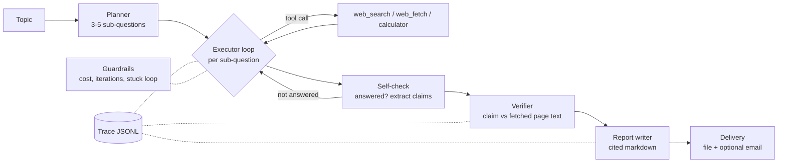

# Research-to-Report Agent

An autonomous agent that takes a topic, plans sub-questions, researches them with web tools, **verifies every claim against the page it cites**, writes a cited report, and can email it.

Built to show the parts of agent engineering that tutorials skip: tool orchestration, failure recovery, cost control, observability and measurement. The agent loop is hand-written (no LangChain/LangGraph) so every step is visible.

## How it works



1. **Planner** turns the topic into sub-questions (logged as a typed `Plan`).
2. **Executor** lets the model call tools. After it stops, a **self-check** call decides whether the question is really answered and extracts atomic claims, each tied to a URL the agent actually fetched. If not answered, the loop continues with feedback.
3. **Verifier** rejects any claim whose URL was never fetched (hallucinated citation), then fact-checks the rest against the stored page text.
4. **Reporter** writes the report from verified claims only, and strips citation numbers that don't exist.
5. **Delivery** saves `reports/<run_id>.md` and optionally emails it.

## Reliability features

| Problem | How it's handled |
|---|---|
| Search returns nothing / provider down | Tavily -> DuckDuckGo fallback; empty results are reported to the model and counted as `search_empty` |
| Page fails to load, blocked, or is a PDF | Retries with backoff on network/5xx/429; error goes back to the model so it can pick another URL (`fetch_failed`) |
| Model returns malformed JSON | Error is fed back and the model is re-asked up to `JSON_MAX_RETRIES` times (`bad_json`) |
| Agent repeats the same call | First repeat is refused with an instruction to change strategy; second repeat aborts that sub-question (`stuck_loop`) |
| Runaway cost | Hard `MAX_COST_USD` ceiling. When hit, research stops, remaining claims are marked *unverified*, and a partial report is still produced (`budget_exceeded`) |
| Runaway loops | Per-sub-question and total iteration caps (`iteration_limit`) |
| Hallucinated citations | Citation must match a page fetched in this run **and** be supported by its text (`hallucinated_citation`) |
| Prompt-injected recipients | Email is **not** a model tool. The pipeline sends only to the address you pass in |
| SSRF via model-chosen URLs | `web_fetch` blocks non-http(s) and private/loopback/link-local addresses on every redirect hop |

`Pipeline.run()` never raises: you always get a `RunResult` with `status` = `success` / `partial` / `failed`, failure counts, cost and latency.

## Quick start

```bash
python -m venv .venv && source .venv/bin/activate     # Windows: .venv\Scripts\activate
pip install -e ".[dev]"
cp .env.example .env                                  # add ANTHROPIC_API_KEY (and optionally TAVILY_API_KEY, SMTP_*)

python cli.py run "State of solid-state batteries in 2026"
python cli.py run "AI chip market" --email you@example.com --max-cost 0.40
python cli.py trace traces/<file>.jsonl               # readable step-by-step trace
```

API:

```bash
uvicorn api.main:app --reload
curl -X POST localhost:8000/runs -H 'content-type: application/json' -d '{"topic": "AI chip market"}'
curl localhost:8000/runs/<run_id>/report
curl localhost:8000/runs/<run_id>/trace
```

Docker:

```bash
docker build -t research-agent .
docker run --env-file .env -p 8000:8000 research-agent
```

## Configuration

All settings are environment variables (see `.env.example`). Important ones:

| Variable | Default | Purpose |
|---|---|---|
| `ANTHROPIC_API_KEY` | - | Required |
| `LLM_MODEL` | `claude-sonnet-5-5` | Model used for every step |
| `PRICE_INPUT_PER_MTOK` / `PRICE_OUTPUT_PER_MTOK` | 3.0 / 15.0 | Used only for the cost ceiling. **Check current pricing and update.** |
| `MAX_COST_USD` | 0.75 | Per-run cost ceiling |
| `MAX_SUBQUESTIONS` | 5 | Plan size cap |
| `MAX_ITERATIONS_PER_SUBQUESTION` / `MAX_TOTAL_ITERATIONS` | 6 / 30 | Loop caps |
| `TAVILY_API_KEY` | empty | Optional primary search provider |
| `SMTP_*` | empty | Optional email delivery |

## Tests

```bash
pytest
```

The tests use a scripted fake LLM and patched network, so they run offline and free. They cover each guardrail, every failure category, graceful degradation (budget exceeded mid-run), SSRF blocking, email building, the API and the eval maths.

## Evaluation

```bash
python evals/run_eval.py --limit 3     # smoke run
python evals/run_eval.py               # all 15 topics in evals/topics.json
```

Reports success / partial / failed rate, average cost, average and p95 latency, and failure categories, and saves them to `evals/results/`. Paste your numbers here after running it:

| Metric | Result |
|---|---|
| Topics | _fill in_ |
| Success rate | _fill in_ |
| Avg cost per report | _fill in_ |
| Avg latency | _fill in_ |
| Top failure categories | _fill in_ |

## Project layout

```
src/agent/
  config.py       settings from env
  models.py       Pydantic types: Plan, Claim, Finding, VerifiedClaim, RunResult
  llm.py          Anthropic wrapper: retries, cost accounting, validated-JSON helper
  planner.py      topic -> sub-questions
  executor.py     tool-use loop + self-check
  verifier.py     claim vs. source-text checking
  reporter.py     cited markdown + deterministic fallback
  guardrails.py   cost ceiling, iteration cap, stuck detector
  tracing.py      JSONL trace + viewer
  pipeline.py     orchestration, graceful degradation
  tools/          Tool interface/registry, search, fetch (SSRF-safe), calculator, email
api/main.py       FastAPI service
cli.py            Typer CLI
evals/            topics + evaluation harness
tests/            offline test suite
```

## Known limitations / next steps

- `POST /runs` is synchronous; production use needs a background worker and polling.
- Sub-questions run sequentially; they are independent, so they could run in parallel.
- The fetcher can't read JavaScript-rendered pages or PDFs.
- DNS-rebinding between the SSRF check and the request isn't fully closed (see comment in `fetch.py`).
- Verification checks claims against the first `VERIFY_CHARS` characters of a page.
